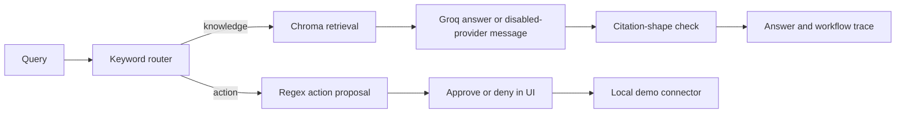

# Document questions, with an action branch

A LangGraph proof of concept for two kinds of operational request: answering questions from indexed PDFs, and proposing a small set of actions for human review. It combines local sentence-transformer embeddings and Chroma retrieval with optional Groq answer generation and a Streamlit interface.

The workflow is implemented as graph nodes, not a team of independently autonomous agents. Its router uses keyword checks, and its “critic” only looks for a citation-shaped string. Those are useful demonstration boundaries, not validated reasoning or factual grounding.

## Follow a request



The UI now displays the graph's completed draft directly. Previously it ran a second model synthesis after the graph finished, doubling provider work and showing an answer that the graph's check had never seen. The workflow trace describes node transitions; it is not an internal reasoning transcript.

## Run against synthetic documents

Use an isolated Python environment compatible with the pinned dependencies. The embedding/model stack is substantial and can download model resources; no GPU performance or live provider result is claimed.

```sh
python -m venv .venv
source .venv/bin/activate
pip install -r requirements.txt
cp .env.example .env
python -m scripts.generate_pdfs
python -m ingestion.build_index
python -m streamlit run apps/ui/streamlit_app.py --server.address 127.0.0.1
```

Run from the repository root. The source PDF folder initially contains only `.gitkeep`; the generator creates demonstration PDFs. To use your own non-sensitive PDFs, place them under `data/raw/` before indexing. The loader reads top-level PDF files, extracts text per page, and splits it by character count with overlap. This is **character chunking**, not semantic segmentation or OCR.

`CHROMA_DB_DIR`, `RAW_DOCS_DIR`, and `EMBEDDING_MODEL` configure indexing. The default collection is `pwb_docs`. `--rebuild` deletes and recreates that collection; use a disposable index. Repeated upserts reuse chunk IDs based on file stem/page/chunk, so renamed files and shorter revised documents need deliberate stale-chunk cleanup.

You can inspect retrieval without asking the model:

```sh
python -m scripts.query_index --q "What are the onboarding steps?" --k 4
```

Without `GROQ_API_KEY`, the knowledge path returns an explicit disabled-provider message alongside retrieved sources. With a key, questions and retrieved text go to the configured provider. Do not index confidential documents or use real operational information in screenshots.

## What approval actually does

The optional connector is [`connectors/ops_stub_api/main.py`](connectors/ops_stub_api/main.py). Run it locally with:

```sh
python -m uvicorn connectors.ops_stub_api.main:app --host 127.0.0.1 --port 8001
```

The UI can propose pause/unpause and opening-hours requests, then send an approved proposal to that stub. It changes local JSON state and appends an audit entry. It does not pause a real service, update a merchant platform, or establish an authenticated approval system. The API has no authentication and its files are not concurrency-safe; keep it local. `OPERATOR_NAME` is a supplied label, not a verified identity.

The keyword router can misclassify explanatory questions that mention action words. The regex parser also needs tests for complete quoted/multiword items before connecting anything real. Do not repoint this demo at operational systems and call its actions safe merely because an approval button exists.

## Evidence and checks

A `[filename pN]` pattern only demonstrates citation formatting. The critic does not establish that the file/page exists, that a statement follows from it, or that the answer is resistant to prompt injection. The trace now calls this `citation_shape_present` instead of `grounded`.

Three dependency-free tests cover empty/short input, preservation across overlapping chunks, and invalid chunk sizes that previously could loop indefinitely:

```sh
python -m unittest discover -s tests -v
```

The Python sources and documentation links are checked as well. The full embedding/indexing stack, Streamlit runtime, connector integration, live Groq requests, and document-answer quality were not exercised in this update. A useful next portfolio artifact would be a real synthetic-document walkthrough showing the source page next to an answer, rather than an invented chat screenshot.

The earlier README referenced `thecodeman001/PWB_AI_Agent` as project context; that history is retained here. No license file is included in this checkout, so the previous unsupported MIT-license claim has been removed rather than inventing license terms.
